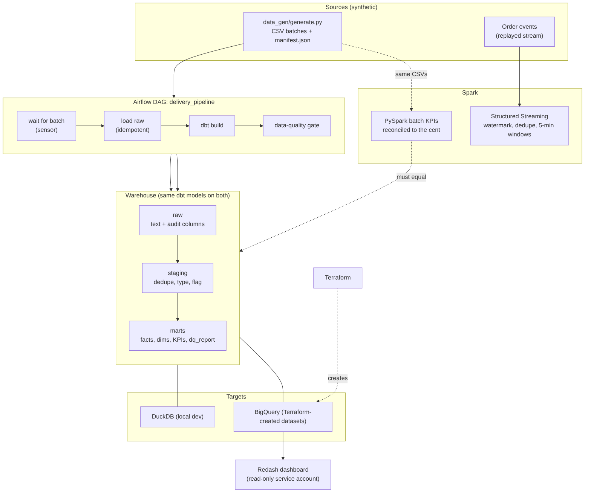

# Delivery Data Platform

A small data-engineering project built around a synthetic on-demand delivery business (customers, merchants, couriers, orders, order events).
It is built in stages; all five stages are in: **data generation, raw ingest, dbt staging and marts, data-quality report, Airflow DAG with a quality gate, BigQuery target, PySpark batch job reconciled with dbt, Spark Structured Streaming, Terraform for the BigQuery datasets, a Redash dashboard, tests**.

## Architecture



Source of the diagram: [docs/architecture.mmd](docs/architecture.mmd) (Mermaid).

## Folders

```
data_gen/generate.py   seeded CSV generator + manifest.json (the list of every planted defect)
ingest/load_raw.py     CSV -> DuckDB schema "raw" (text columns + _batch_id, _source_file, _loaded_at), idempotent per batch
dbt_project/           dbt staging models: dedupe, typing, status clean-up, data-quality flags, tests
dags/                  Airflow DAG: wait for batch -> load raw -> dbt build -> data-quality gate
pipeline/tasks.py      the DAG's steps as plain Python (testable without Airflow)
ingest/load_bigquery.py  same raw load for BigQuery
spark_jobs/            PySpark batch job (daily KPIs) that is reconciled with the dbt mart
streaming/             event producer (Kafka or files) and Spark Structured Streaming job
terraform/             BigQuery datasets (raw, staging, marts) and a read-only Redash service account as code
redash/                Redash on Docker, 7 dashboard queries, setup notes
tests/                 pytest checks of staging, marts, the data-quality report and the incremental model against manifest.json
```

## Run it (Windows cmd)

```
python -m venv venv
venv\Scripts\activate
pip install -r requirements.txt
scripts\run_pipeline.bat
```

## Orchestration and BigQuery

- **Airflow:** `dags/delivery_pipeline.py`, details and what was verified in [docs/AIRFLOW.md](docs/AIRFLOW.md).
- **BigQuery:** the same dbt models run on DuckDB (`dev`) and BigQuery (`bq`, `bq_sandbox`) through cross-database macros, see [docs/BIGQUERY.md](docs/BIGQUERY.md).
  Run by the author on a free BigQuery sandbox. Money was changed from floating point to exact decimals after a cross-engine check found a one-cent rounding bug (see docs/SPARK_AND_STREAMING.md). The BigQuery build was then repeated and all six queries in `scripts/bq_verify.sql` matched, including total commission 709496.31 (it was 709489.92 with floats).

## Infrastructure and dashboard

- **Terraform:** `terraform/` defines the three BigQuery datasets and a read-only service account for the dashboard. Steps: [docs/TERRAFORM_AND_REDASH.md](docs/TERRAFORM_AND_REDASH.md).
- **Redash:** `redash/` runs Redash locally with Docker and holds the 7 dashboard queries (`redash/queries/`). The 7 queries run on both DuckDB and BigQuery marts, which have the same tables.

## Spark and streaming

PySpark batch job reconciled with the dbt mart to the cent on all 90 days, and a Structured Streaming job (watermark, deduplication, 5-minute windows) tested over a replay of 304,156 events. Details, what was verified and what was not: [docs/SPARK_AND_STREAMING.md](docs/SPARK_AND_STREAMING.md).

## Data model (marts)

| Model | Kind | What it is |
|---|---|---|
| `fct_orders` | incremental | one row per valid order: gmv, commission, delivery minutes, late flag, event times |
| `dim_customers`, `dim_merchants`, `dim_couriers` | table | descriptive attributes + lifetime numbers (customer segment: never_ordered / one_time / repeat / loyal) |
| `mart_customer_orders` | table | window functions: order sequence, previous order, days between orders, running spend |
| `mart_courier_daily` | table | deliveries per courier per day, rolling 7-day average, rank inside the home zone |
| `mart_daily_kpis` | table | orders, gmv, cancel rate, average and p90 delivery time, on-time rate, 7-day average, week-over-week change |
| `mart_cohort_retention` | table | monthly cohorts and how many ordered again N months later |
| `dq_report` | table | one row per data-quality check: how many rows were affected, fixed or excluded |

Orders with a data-quality flag are **kept out of `fct_orders`** and counted in `dq_report`; `assert_valid_plus_excluded_equals_staging` proves none disappear silently.

`fct_orders` is incremental: a normal run rebuilds only orders from (latest `placed_ts` - 1 day), replacing rows by `order_id`.
If the model logic or the source data changes, run `dbt run --full-refresh` (the run scripts do), otherwise old rows keep the old logic.

Known limits: the first monthly cohort contains customers who already existed before the data window starts, so its retention looks high.

## What the data contains on purpose

The generator plants known problems and records each one in `manifest.json`: duplicate orders and events (at-least-once delivery),
changed customer rows, mixed-case / padded statuses, non-positive subtotals, orders completed before they were placed,
couriers that do not exist, missing customer ids, unparseable timestamps. The staging layer must find exactly these, no more, no fewer.
`tests/test_pipeline.py` compares the flagged order ids with the manifest id by id.

## Design decisions

- Raw is never edited; every cleaning rule lives in a dbt model so it can be read and tested.
- Bad rows are **flagged, not deleted** (`flag_*` columns, `is_valid`), so marts choose what to count and the data-quality report can count what was found.
- Loading a batch twice replaces that batch's rows (no duplicates).
- Data is synthetic. No real company data is used.

## Status

| Part | State |
|---|---|
| Generator, ingest, dbt staging + marts, data-quality report | built; run end to end on DuckDB: 53 dbt checks pass |
| Task layer + quality gate | built; unit tested |
| Airflow DAG | built; run with `airflow dags test` on Airflow 3.3.2, success and failure path (Linux). Docker file and Windows not tested |
| BigQuery models and loader | run by the author on the sandbox; after the decimal-money fix all six checks in `scripts/bq_verify.sql` match |
| PySpark batch job | built; equals the dbt mart on every metric and day |
| Streaming (producer, Structured Streaming job) | built; logic tested with real Spark over files. The author ran the Spark, WSL and Redpanda steps on their own machine and reported all tests passing |
| Terraform | run by the author: `terraform apply` created 6 resources (3 BigQuery datasets, a read-only service account, 2 permissions); the pipeline was then reloaded into those datasets |
| Redash | run by the author on Docker: connected to BigQuery with the read-only account and loaded the dashboard from the 7 queries |

Tests: `pytest -q`. Tests that need Airflow, the Google client, or Spark and Java skip themselves when those are not installed.

## AI assistance

This project is built with the help of Claude (Anthropic), which wrote most of the code. The author is responsible for understanding it,
and the explanation notes for each stage are written so the code can be explained line by line.
